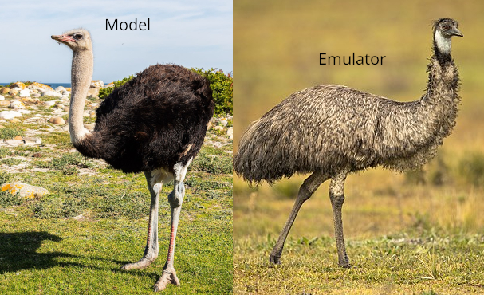

# emueg: an emulator example

[](https://colab.research.google.com/github/krisaalstad/emueg/blob/main/emueg.ipynb)

A short, hands-on demonstration of **model emulation** (surrogate modelling) with machine learning. A Gaussian process, random forest, or support vector regression is trained on a small fraction (<1%) of pixels to emulate an expensive spectral unmixing retrieval of fractional snow-covered area (fSCA) from Sentinel-2 surface reflectances, and then predicts fSCA for the whole scene in seconds.




*Ostrich: [Author], [licence]. Emu: JJ Harrison, CC BY-SA 4.0. Both via Wikimedia Commons; combined and labelled by K. Aalstad, CC BY-SA 4.0.*

Originally developed as a demonstration for the course GEO4300/GEO9300 at the Department of Geosciences, University of Oslo. A modified version of this technique is used actively by us in research to generate large scale spectrally unmixied fSCA retrieval maps from Sentinel-2 and Landsat imagery.

## What the notebook covers

- Loading a Sentinel-2 scene (6 bands: R, G, B, NIR, SWIR1, SWIR2) and the corresponding unmixed fSCA
- Training an emulator on a random subset of pixels using `scikit-learn`
- Evaluating the emulator on held-out pixels (RMSE, R²)
- Using the Gaussian process predictive uncertainty to check calibration
- Inspecting the learned (ARD) length scales to see which bands matter most
- Trying out different plug-and-play supervised machine learning techniques (random forest, support vector machine, and Gaussian process regression)

## Getting started

### Option 1: Google Colab (no installation)

Click the **Open in Colab** badge above and run all cells. The notebook downloads the data automatically.

### Option 2: Locally with uv (recommended)

```bash
git clone https://github.com/krisaalstad/emueg.git
cd emueg
uv sync
uv run jupyter lab
```

Then open `emueg.ipynb`. If you use Positron or VS Code, select `.venv/bin/python` as the interpreter.

### Option 3: Locally with pip

```bash
git clone https://github.com/krisaalstad/emueg.git
cd emueg
pip install numpy matplotlib scikit-learn netCDF4 jupyterlab
jupyter lab
```

## Data

`S2_FCLSUM_MLB.nc` contains Sentinel-2 surface reflectances and fSCA retrieved by spectral unmixing for the Mammoth Lakes basin in the Californian Sierra Nevada (around 37.6°N, 119°W) on 7 May 2018, at 10 m resolution (784 × 731 pixels). The retrieval method is described in [Aalstad et al. (2020)](https://doi.org/10.1016/j.rse.2019.111618). Contains modified Copernicus Sentinel-2 data (2018).

## References

- Aalstad, K. et al. (2020). Evaluating satellite retrieved fractional snow-covered area at a high-Arctic site using terrestrial photography. *Remote Sensing of Environment*, https://doi.org/10.1016/j.rse.2019.111618
- Gramacy, R. B. (2020). *Surrogates: Gaussian Process Modeling, Design, and Optimization for the Applied Sciences*. Chapman & Hall/CRC. https://bobby.gramacy.com/surrogates/
- Mazzolini, M. et al. (2025). Spatio-temporal snow data assimilation with the ICESat-2 laser altimeter. *The Cryosphere*,  https://doi.org/10.5194/tc-19-3831-2025
- Willmes, C. et al. (2025). Assimilating high-resolution satellite snow cover data in a permafrost model. *The Cryosphere (accepted)*, https://doi.org/10.5194/egusphere-2025-3142

## Licence and credits

- **Code** (the notebook): MIT licence, see [LICENSE](LICENSE).
- **Data** (`S2_FCLSUM_MLB.nc`): CC BY 4.0.
- **Image** (`images/emulators.jpg`): CC BY-SA 4.0, combined and labelled by Kristoffer Aalstad from Wikimedia Commons photos:
  - Ostrich: [Diego Delso](https://commons.wikimedia.org/wiki/File:Avestruz_de_cuello_azul_(Struthio_camelus_australis),_cabo_de_Buena_Esparanza,_Sud%C3%A1frica,_2018-07-23,_DD_87.jpg), CC BY-SA 4.0
  - Emu: [JJ Harrison](https://commons.wikimedia.org/wiki/File:Emu_1_-_Tidbinbilla.jpg), CC BY-SA 4.0

## Contact

Kristoffer Aalstad, Department of Geosciences, University of Oslo (kristoffer.aalstad@geo.uio.no)
